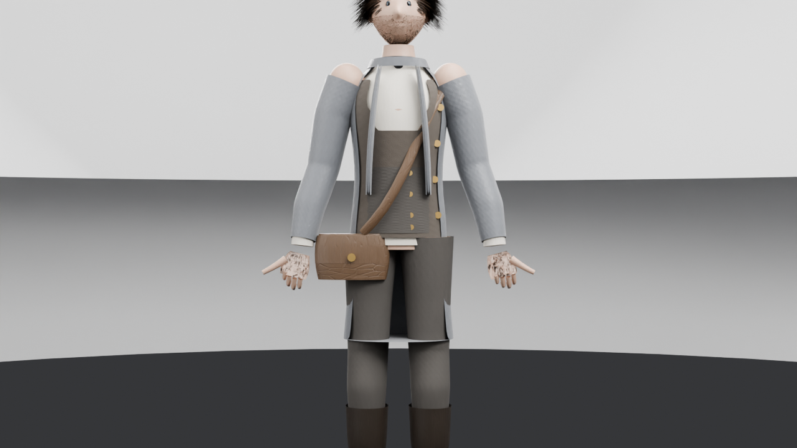
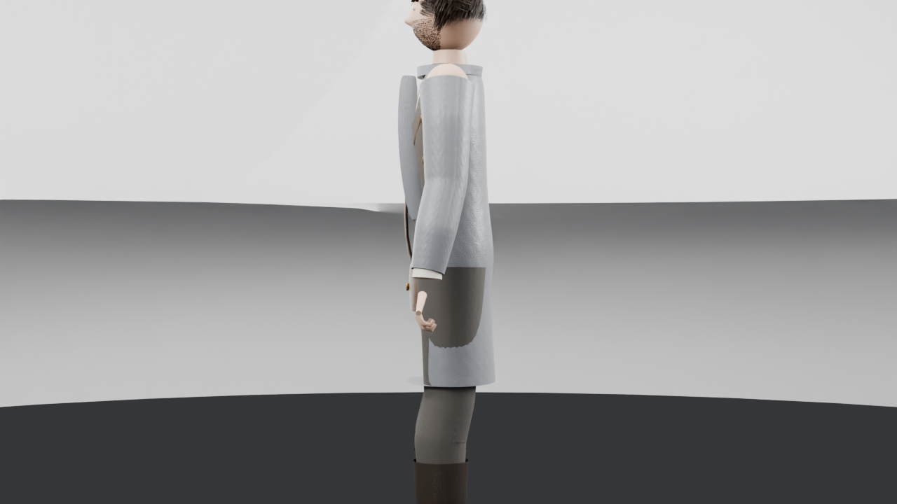
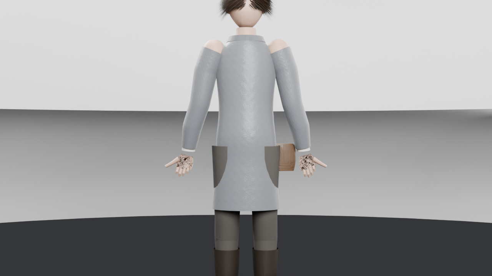
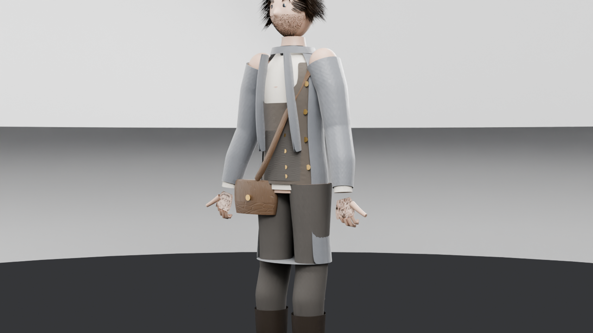
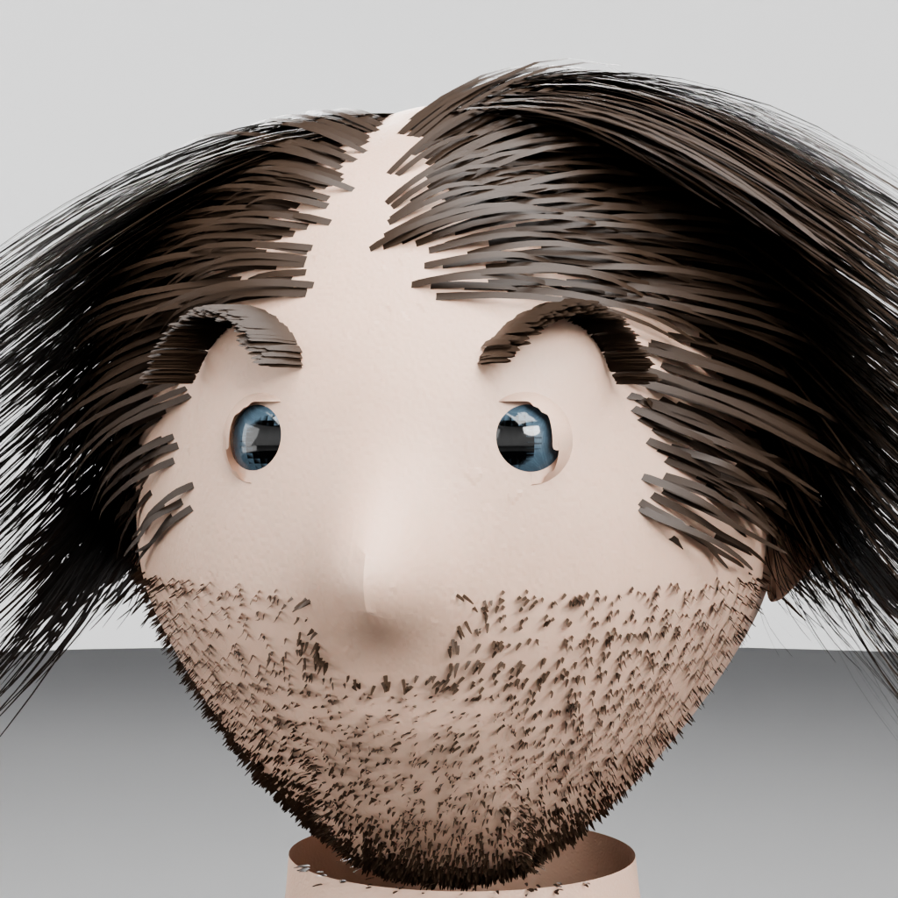
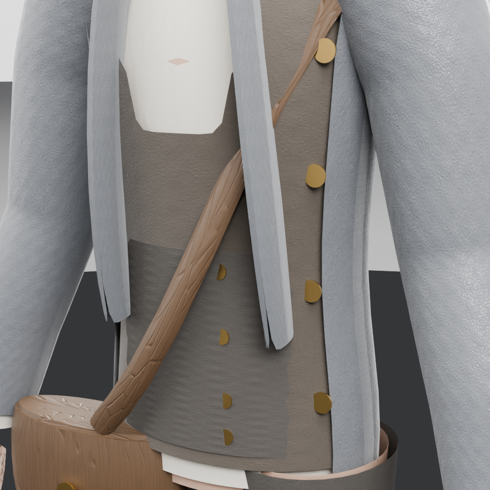
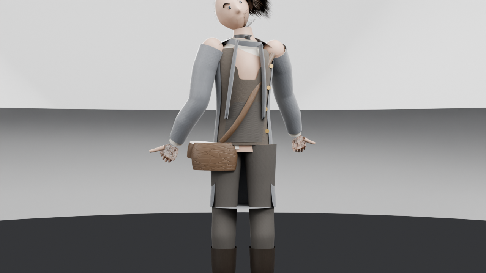
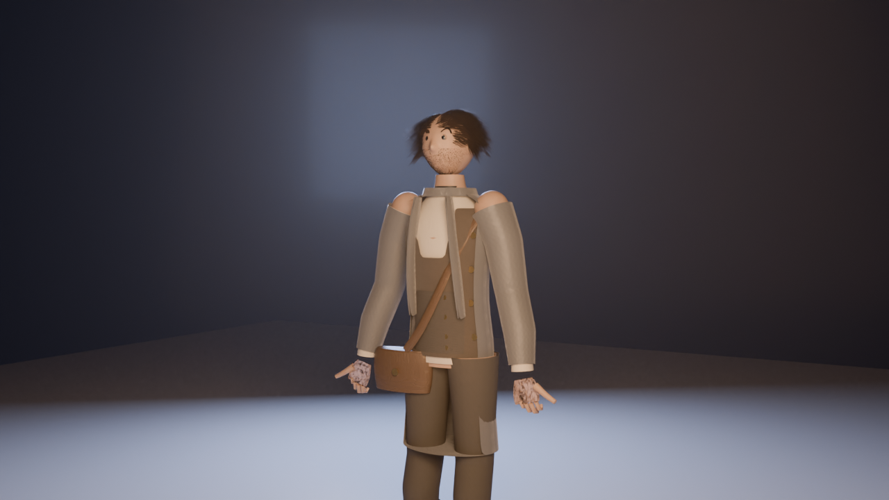

# M3.4 — بناء أول شخصية حقيقية: إدموند ڤيل (Edmund Vale) — THE LAST SIN: The Sin-Eater

> التاريخ: 2026-10-23 · الفرع: `feature/m3-4-edmund-character` · الأساس: main @ `7c3d39b`
> التنفيذ الفعلي: **Blender 5.0.1 headless** (نفس إصدار أصول المعايرة في المستودع) على Linux بلا GPU — رندر Cycles CPU مع OpenImageDenoise.
> الشخصية منشأة **إجرائيًا بالكامل عبر Python داخل Blender** (المسار C في المواصفة) — لا نماذج خارجية، لا أصول محمية، لا صور مولّدة خارجيًا.

## ما الذي يوجد فعليًا الآن

**TLS-CHR-001 إدموند ڤيل** — نموذج بشري كامل قابل للفتح والتعديل، مطابق لمواصفة `docs/CHARACTER_REGISTRY.md` (CHR-01): قامة 1.78 م، جذع نحيل بكتفين صلبتين، شعر بني داكن متطاول غير مهتم به، لحية أسبوعين، عينان رماديتان، **بقعة حبر دائمة على اليد اليسرى**، معطف لندني رمادي + قميص كتان + سترة + منديل رقبة + بنطال صوف + حذاء جلد + **حقيبة نقش جلدية بحزام عبر الصدر وأزرار نحاسية**.

| الملف | المسار | الحجم |
|---|---|---|
| ملف Blender الكامل (شخصية + هيكل + خامات معبأة) | `02_Art/blender/source/chr/tls_chr_001_edmund_vale.blend` | 3.8 MB |
| FBX هيكلي (جسم + رأس + يدان + عينان + 65 عظمة) | `02_Art/exports/fbx/tls_chr_001_edmund_vale_v001.fbx` | 1.1 MB |
| FBX الزي اليومي (7 قطع + الهيكل) | `02_Art/exports/fbx/tls_chr_030_edmund_outfit_v001.fbx` | 0.9 MB |
| الهيكل المستقل TLS-SKL-001 (65 عظمة) | `02_Art/blender/source/rig/tls_skl_001_rig_human.blend` + FBX | 1.3 MB |
| ملفات textures الفعلية (مولّدة numpy) | `02_Art/Characters/Edmund/textures/` (4 PNG) | 1.2 MB |
| سكربتات البناء القابلة لإعادة التشغيل | `02_Art/Characters/Edmund/build_scripts/` (10 ملفات) | — |
| الرندرات التسعة من النموذج نفسه | `renders/` (هذا المجلد) | 9.3 MB |

## الرندرات (كلها من ملف `.blend` الناتج نفسه — Cycles CPU)

| الصورة | ما تُظهره |
|---|---|
|  | أمامي كامل — وضعية A (ميل 15° وفق TLS-SKL-001) |
|  | جانبي كامل |
|  | خلفي كامل (ظهرة المعطف والياقة) |
|  | ثلاثة أرباع — ملامح الوجه والملابس |
|  | لقطة قريبة للوجه 1024px |
|  | تفصيل الخامات: صوف/كتان/نحاس/جلد |
|  | وضعية A للاستعداد للـ rig |
|  | **اختبار تشوه فعلي**: استدارة رأس 28.6° + رفع كتف 34.4° + ثني مرفق 40° |
|  | لقطة سينمائية بإضاءة الجو الليلي للعبة |

## الأرقام الحقيقية (من `data/`)

- **الشبكة**: 22,457 رأسًا / 39,408 مثلث (الميش الأساس = نسخة اللعبة) + شعر بطاقات 53,168 مثلث + لحية 20,800 + حواجب 2,400
- **الارتفاع المقاس**: 1.7685 م (قمة التاج 1.781 م — مطابقة المواصفة 1.78 م)
- **FBX يعيد الاستيراد عند 1.764 م** بـ 65 عظمة وكل الخامات (تحقق بجلسة Blender جديدة)
- **الخامات**: 15 مادة PBR (جلد بنفاذ ضوئي، صوف، كتان، حرير، جلد طبيعي، نحاس معدني…) + 4 ملفات texture مولّدة فعليًا
- **الهيكل**: 65 عظمة بالضبط (عقود TLS-SKL-001: عمود فقري 3 + صدر + رقبة + رأس + عينان + ترقوة + ذراع بكامل الأصابع 15 عظمة/يد + رجل بكاحل وقدم + `satchel_anchor` للفانوس لاحقًا)
- **الـ skinning**: أوزان تلقائية — **صفر رؤوس بلا أوزان** — و5 اختبارات تشوه موثقة في `QUALITY_REPORT.md`

## الحدود الصادقة (اقرأ قبل الحكم)

1. **الوجه واقعي-منمق (stylized) وليس نحتًا يدويًا فوتوغرافيًا**: بُني بحقول إزاحة تشريحية بارامترية (أنف/حواجب/شفتان/فك/جفون/حجرات عين). يُقرأ كوجه بشري كامل الملامح — ليس كرة رأس — لكنه دون مستوى النحت اليدوي AAA. المسار الصادق التالي: نحت تفصيلي فوق هذه القاعدة + إعادة topology للوجه.
2. **الملابس meshes منفصلة بأوزان تلقائية بلا محاكاة قماش**: في لقطة اختبار الـ rig يظهر انفتاح المعطف وكشف جزء من الصدر عند رفع الكتف (موثق بصريًا). الوضعية A سليمة.
3. **UNREAL IMPORT NOT TESTED** — لا يوجد UE 5.4 في بيئة التنفيذ (Linux حاوية بلا GPU). اتفاقية FBX مطابقة لوثيقة `TECHNICAL_PIPELINE.md` (`-Y/Z`, `FBX_SCALE_UNITS`) وتم التحقق بإعادة استيراد FBX في Blender فقط.
4. الأذنان منمقتان مبسطتان، والشعر بطاقات إجرائية دون رندر خصلات حقيقي.

التقسيم الكامل between ما نُفّذ وما هو مخطط في [QUALITY_REPORT.md](QUALITY_REPORT.md).
